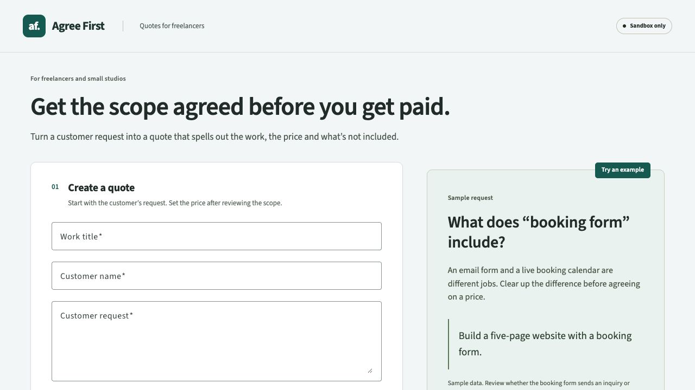

# Agree First

**Agree on the scope before you get paid.**

A freelancer hears “a website with a booking form.” The customer might mean an inquiry form, or a live scheduling system. Agree First turns that ambiguity into an explicit question, a human-reviewed scope, and one fixed price before PayPal sandbox checkout.

AI helps draft the agreement and compare effort with and without an AI agent. The freelancer settles the details and chooses the price. The customer reviews the approved revision. PayPal confirms payment against that exact revision and amount.



## Run it on macOS or Linux

Use **Node 22.23.3** and npm. If you use nvm, the repository includes `.nvmrc`:

```sh
nvm install
nvm use
npm ci
npm run build
npm start
```

Open **http://127.0.0.1:3001**. Keep the terminal running. `Ctrl+C` stops the app. Without nvm, install Node 22.23.3 from [Node.js](https://nodejs.org/download/release/v22.23.3/), then use the npm commands above. Native SQLite requires a supported Node version; reinstall with `npm ci` after changing Node.

For development, `npm run dev` starts Angular on http://127.0.0.1:4200 and the API on port 3001. Do not run development and production servers together on port 3001.

Windows: `scripts/setup.ps1` installs a checksum-verified local Node runtime. Then run `scripts/run.ps1 dev`. See [Windows and integration details](docs/windows-and-integrations.md).

## Judge walkthrough: no account required for the sample

1. Choose **Use this example**. The scope and questions are visibly labeled as predefined sample content.
2. Follow the highlighted **booking form** phrase to its question. Approval stays disabled until it is answered or an explicit assumption is recorded.
3. Choose **We have an answer** and enter `An inquiry form only; no live calendar.`
4. Enter an hourly rate such as `50` and choose **Estimate work**. The sample compares the same work in both delivery approaches. Choose a suggestion explicitly, or enter your own total such as `450.50`.
5. Choose **Approve scope & price**, then **Customer view**. Review inclusions, exclusions, customer inputs, settled details, and the exact EUR total. **Print / save agreement** opens the browser's print/PDF dialog.
6. Without credentials, checkout displays a setup message and stays unpaid. With sandbox credentials, confirm the agreement and complete PayPal checkout using a personal sandbox buyer or a [published sandbox test card](https://developer.paypal.com/sandbox-testing/card-testing).
7. A completed payment displays the stored order and capture references. Reload to verify persistence. Paid agreements are read-only.

The sample walkthrough is deterministic and consumes no AI credits. A **fresh request** plus **Generate AI draft** is the live AI demonstration; do not present the labeled sample as a live model response.

## Connect real services

Copy `.env.example` to `.env` in the repository root. Never commit or share `.env`. Set:

```dotenv
PAYPAL_CLIENT_ID=your-sandbox-app-client-id
PAYPAL_CLIENT_SECRET=your-sandbox-app-client-secret
ASTRO_GATEWAY_URL=your-https-gateway-base-url
ASTRO_GATEWAY_API_KEY=your-gateway-api-key
MODEL_DEFAULT=claude-haiku-4-5
```

Get a sandbox application and separate personal buyer from the [PayPal Developer Dashboard](https://developer.paypal.com/dashboard/). Use sandbox credentials only. The server calls only `api-m.sandbox.paypal.com`; there is no live-money mode.

For live AI, use the [Astropods AI gateway](https://docs.astropods.com/ai-gateway). To connect without copying credentials by hand, keep Docker Desktop running and use:

```sh
npm run ai:setup
npm run ai:login
npm run ai:connect
```

The setup pins Astropods CLI 0.32.0 and verifies its official SHA-256 before installation. Login prints a device URL and code; authorize it in your browser. Connect runs an isolated local helper, transfers the temporary gateway settings directly into an ignored runtime file, then stops the helper. It does not publish or deploy the project. The same commands support macOS, Linux and Windows on x64/ARM64. Existing PowerShell wrappers use the same installer; see [integration details](docs/windows-and-integrations.md).

The backend reloads private runtime settings automatically; refresh the app after connecting. Manual gateway settings in `.env` or your shell take precedence over the helper file, so leave both `ASTRO_GATEWAY_URL` and `ASTRO_GATEWAY_API_KEY` blank when using the helper. Account allowance and key expiry are controlled by the provider; check them before the demo. Do not buy credits without approval.

Restart the server after editing `.env`. Run `npm run doctor` to check readiness without printing secrets or contacting providers. In the app, create a new request, choose **Generate AI draft**, settle its questions, then **Estimate work**. AI can draft and estimate; it cannot approve, change the final price automatically, or pay.

Only the public PayPal client ID is sent to the browser. OAuth tokens, client secrets and AI credentials stay on the server. Judges can use their own sandbox application and gateway credentials with the instructions above; no private repository account or paid application subscription is required to run the local sample.

## Verify

```sh
npm run browsers:install
npm run verify
```

`verify` runs API type checking, backend and frontend unit tests, the gateway-helper tests, a production build, and desktop/mobile browser journeys. On a Linux CI runner, use `npm run browsers:install -- --with-deps`. Browser tests need free loopback ports **3001 and 3002**. They use disposable SQLite databases and controlled providers; they never load local payment credentials or consume AI credits. The SDK/payment fixture is in `tests/support`, outside the production build.

See [test coverage and live checks](docs/testing.md) and [judge instructions](docs/judging.md). The GitHub Actions workflow runs the same verification after publication; its remote result must be checked separately.

## How it works

- `apps/web`: Angular 22 and Angular Material; responsive editor, effort comparison, customer review and receipt.
- `apps/api`: Express, SQLite/Drizzle, approval rules, AI gateway and PayPal Orders v2.
- `packages/shared`: Zod contracts, types and integer-cent money calculations.
- `tests`: desktop/mobile workflows, including real API/storage with isolated provider fixtures.

Approval stores a snapshot of the scope, assumptions, customer, price and revision. Editing an unpaid quote invalidates approval. Order creation and capture use server-side amounts and saved retry identifiers. The server checks quote linkage, currency, total, recipient and completed capture before storing a receipt. An uncertain capture blocks edits and recovers the same order after reload. Attempts older than five hours require a manual sandbox check.

Data is local in `work/agree-first.sqlite`; use `AGREE_FIRST_DATABASE_PATH` to choose another path. `PORT` defaults to 3001. The API binds to loopback and rejects cross-site requests. [Architecture and tradeoffs](docs/architecture.md).

## Scope of this prototype

This is a local workspace for one freelancer. Customer view is a local review page, not a remote sharing portal. Authentication, teams, email delivery, tax, refunds, deposits and production payments are outside this build. Effort ranges are suggestions, not measured productivity gains, market rates or guaranteed savings. The tool is intended to clarify scope; it cannot guarantee the absence of disagreements.

## Submission preparation

[Official challenge](https://paypalaihackathon.devpost.com/) · [Official rules](https://paypalaihackathon.devpost.com/rules) · [Submission draft](docs/submission.md) · [Demo script](docs/demo-script.md) · [Review checklist](docs/review-checklist.md)

Deadline checked on 10 November 2026: **12 November 2026, 12:00 PST / 20:00 UTC / 23:00 Asia/Baghdad**. Recheck the official page before submitting. The owner approved source and demo publication on 10 November 2026. Final Devpost submission remains with the owner.

Source license: [MIT](LICENSE), prepared for owner review before public release. Dependency licenses continue to apply.
