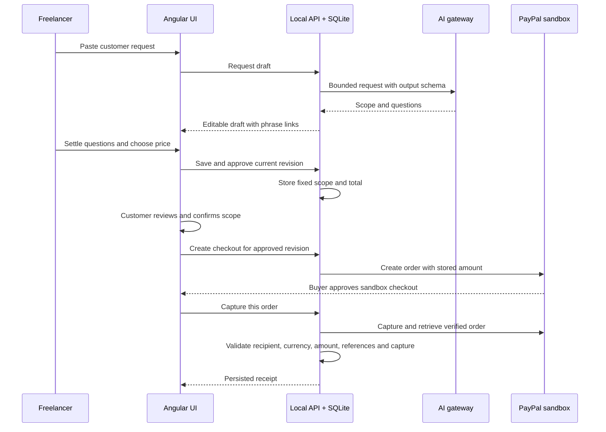

# Architecture and decisions

The browser sends validated JSON to an API. The local build uses Express and SQLite; the hosted build serves the same Angular interface and quote/payment service through a Cloudflare Worker and D1. The API is the authority for revisions, prices, approval and payment status. SQLite stores quote payloads, immutable approval snapshots and retry identifiers. AI and PayPal run behind separate provider interfaces, which makes error paths testable without external calls.

## Why PayPal is central

The approved agreement determines the purchase unit, total and revision in the PayPal order. A receipt exists only after the API verifies a completed capture against those stored values. Checkout is the final step of the scope agreement, rather than an unrelated donate button.

## Human decisions

AI receives the request and scope as untrusted data and has no execution tools. Its response must satisfy a strict schema, including question phrases that exist in the original request. Draft generation does not assign a price. Effort estimation produces time ranges; integer-cent calculations apply the freelancer's hourly rate. A person must explicitly choose any suggested total. Approval and customer confirmation remain separate actions.

## Recovery

A quote-level operation lock and optimistic revisions reject concurrent/stale updates. The database stores distinct create/capture idempotency identifiers. Uncertain capture results keep the quote locked for reconciliation against the same order. Reload restores that recovery state and asks for consent again. Matching completed receipts are idempotent; retrying cannot create a second application receipt.

## Deliberate limits

SQLite keeps local setup small. The public demo uses isolated anonymous browser workspaces in D1, with fenced per-quote leases and atomic quote/payment-attempt updates. It checkpoints state before external payment calls. A customer portal would additionally need authenticated identities, access-controlled cross-device sharing, payment webhooks and an operational reconciliation process. See [hosting details](hosting.md). The current receipt is a sandbox payment record, not a tax invoice or an escrow guarantee.
